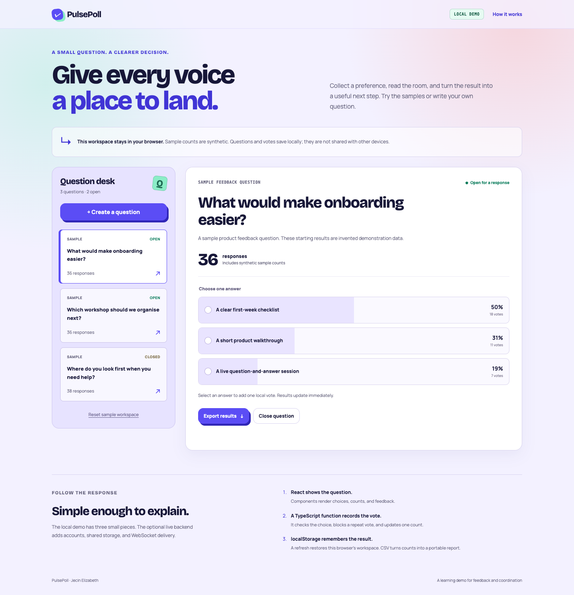
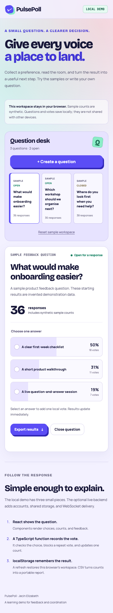

# PulsePoll

A feedback workspace for asking a clear question, collecting a preference, and explaining the result. This learning edition adds an easy-to-run local demo to a shared team polling project.



## Start in two minutes

You need Node.js 22.12+ or a current Node.js 24 release. No database, Docker account, API key, or paid service is needed for the default demo.

```bash
cd frontend
npm ci
npm run dev
```

Open `http://localhost:5173`. The **Local demo** badge confirms that the app is using the browser-only workspace.

## Try the workflow

1. Open one of the three sample questions. Each sample identifies its synthetic starting counts.
2. Choose an answer. One count increases, percentages update, and other choices become disabled.
3. Refresh. The result and repeat-vote marker are restored from this browser's local storage.
4. Create your own question with 2–10 different answer choices.
5. Close or reopen the question, then export the results as CSV.
6. Use **Reset sample workspace** to restore the original examples after confirming the reset.



## What the demo does

- Three starter questions for product onboarding, class coordination, and support preferences.
- Question creation with input validation.
- One recorded vote per question in this browser's saved workspace.
- Immediate totals and percentages, open/close controls, and a CSV report.
- Versioned browser storage with recovery from corrupt data and a visible warning if saving is blocked.
- Keyboard focus styles, small-screen layouts, and reduced-motion support.

The local store is deliberately small enough to read alongside the UI. Start with the [30-minute beginner guide](BEGINNER_GUIDE.md).

## Two modes, different promises

| | Default local demo | Optional live mode |
|---|---|---|
| Data | Browser localStorage | MongoDB; Redis for live delivery |
| Interface | One feedback workspace | Accounts, poll dashboard, shared poll links |
| Updates | Immediate within the same workspace | REST snapshots and WebSockets |
| Setup | `npm ci` and `npm run dev` | Docker Compose or separately configured services |
| Best use | Learning and a small interview walkthrough | Studying the inherited backend architecture |

Local mode does not share polls across computers. Clearing browser data resets its vote restriction. Private windows have separate data. It has no authentication, secure voting identity, transactional concurrency, server backup, or production availability guarantee. A same-browser tab can pick up storage changes, but simultaneous writes can still overwrite each other. Use invented examples, not personal or sensitive responses.

## How the local version works

```text
DemoApp.tsx
  question form / voting / result view
             |
             v
store.ts
  validate -> update a copy of state -> calculate counts
             |
             v
localStorage (pulsepoll:demo:v1)
  restores questions and the browser's previous choices

CSV export reads the same state shown on screen.
```

`store.ts` contains the data rules; React components display state and call those rules after a click. No external AI model is used by this polling application.

## Verify locally

```bash
cd frontend
npm test
npm run build
npm audit --audit-level=high
npm run preview
```

Tests cover vote counting, duplicate-vote rejection, closed questions, reopening, question validation, persistence, corrupt or blocked storage, CSV quoting, formula protection, and the rendered voting workflow. The production build also runs TypeScript checking.

The checked-in `docs/screenshots/demo-*.png` images were captured from the running local demo. They show sample data, not deployed customer activity.

See [recorded local checks](docs/LOCAL_DEMO_VERIFICATION.md) for results and a reproducible browser-check command.

## Optional live backend

The shared project also includes the Go/Gin backend, MongoDB durable storage, Redis outbox relay, WebSocket flow, owner accounts, and QR sharing. These are advanced study material and are separate from the simple local store.

With Docker Desktop running, from the repository root:

```bash
docker compose up --build
```

Open `http://localhost`. The frontend Docker image explicitly builds with `VITE_PULSEPOLL_MODE=live`. For a native frontend connecting to a running backend:

```bash
cd frontend
VITE_PULSEPOLL_MODE=live VITE_PROXY_TARGET=http://localhost:8082 npm run dev
```

The `8082` backend port is exposed by `docker-compose.dev.yml`; start the development override if using that command. See [advanced local setup](docs/DEPLOYMENT.md) and [backend architecture](docs/ARCHITECTURE.md). Advanced backend behavior has not been re-certified by the local-demo checks; run its integration tests before relying on it.

## Repository map

```text
frontend/src/demo/       local workspace, pure store, behavior tests
frontend/src/pages/      inherited live-mode pages
frontend/src/lib/        inherited live API client and auth
backend/                optional Go API
docs/screenshots/       real captures of the local demo
BEGINNER_GUIDE.md        30-minute walkthrough and interview questions
```

## Maintainer and license

Learning edition maintained by **Jecin Elizabeth**. This edition builds on shared team code and adds a browser-only feedback workflow, validation, tests, and learning documentation. The existing MIT contributor copyright and permission notice remain in [LICENSE](LICENSE).
